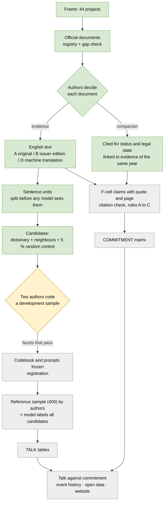

# CBDC privacy dataset: project brief

**One page to read first.** What the project is for, how it works, what is done, and which parts a second model has audited. Kept current: the numbers below are generated from the data files and checked in CI; the rest is updated at the end of every working session. Working rules for any assistant are in [`AGENTS.md`](AGENTS.md).

Authors: Martin Bok (MB), Dominik Stroukal (DS), Prague University of Economics and Business. Target: a measurement-and-data paper in *Data & Policy*, self-imposed deadline 31 Dec 2026. Technical collaborator: an LLM (Claude), supervised by the authors.

## 1. Goal

**Question.** When the makers of a retail central bank digital currency say it will respect privacy, what exactly do they say, and what have they committed to?

**Product.** An open, auditable dataset built only from official documents, in which every value leads to a document, a page and a sentence, with two layers that are never mixed:

- **Talk**: every statement about users' privacy, identifiability or data access in the project's own documents, labelled by who speaks, which aspect of privacy it concerns, and (if human coders can agree on them) stance, basis, decision status and implementation.
- **Commitment**: twelve design features (F1 to F12, e.g. *can the central bank link a payment to a person?*), counted only when the competent body has decided them or the system runs them ([measurement contract](docs/MEASUREMENT_CONTRACT_v12_DRAFT.md), rules A to C).

**What the paper will report.** Per aspect, which projects talk about it in their own voice and which have an admissible commitment (a 2 × 2 table of named projects); the highest rung each project has reached per aspect (declaration, policy, legal or technical basis, decided, operational); an event history per project (the year each rung was first reached); corpus-level series by year; coverage and missingness.

**What it will not claim.** No ranking of projects by amount of privacy talk, no difference of a talk and a commitment index, no "silent" projects, no yearly share per project, no causal language. Whose voice: the executive side of the project, usually led by the central bank. Acts of a legislature are companions: cited, linked, never measured as talk.

## 2. Pipeline

Green: done. Yellow: in progress (waiting for the authors' coding). Grey: not started. The colours are set by hand in this file when a step changes.

## 3. Where things stand

<!-- NUMBERS:BEGIN (generated by scripts/pipeline/update_brief.py; do not edit by hand) -->
State of the data files as of **2026-11-13** (dates are those of the files, not of the day you read this).

| | |
|---|---|
| Analytic frame | **44 projects** = 43 national retail candidates + the digital euro |
| Official documents collected | 777 files in the master folder; 772 document rows, each with an author or model decision |
| Evidence documents (in the frame) | **230 publications** (234 rows); 234 of 234 decided or confirmed by an author |
| Companion documents (in the frame) | 283, cited and linked to evidence of the same year; 64 reviewed by an author |
| Tiers by number of evidence publications | T1 (8+): 8 · EU, IL, JM, JP, KZ, SE, TW, UK T2 (5 to 7): 8 · AU, BS, CA, HK, IN, NO, NZ, RU T3 (4 or fewer): 28 |
| English text for measurement | 208 documents of 42 projects: 163 English originals, 15 issuer English editions, 30 machine translations; 22 evidence documents still without English text |
| Machine translation | 3 API runs, 199 calls, 43 documents translated (benchmark translations excluded) |
| Sentence units | 174 052 units; 20 059 candidates for classification (dictionary hits 8 088, neighbours 6 231, random control 5 740) |
| Human coding | development sample: drawn, 120 units; scored: **not yet** · reference sample (400): not drawn |
| Human judgement of translation | matched pairs scored (MB, one judge): same meaning and strength 59%, weaker 5%, stronger 6%, meaning differs 30% (weighted to 163 matched sentences) · unmatched supplement: **not filled in** |
| Model classification of units | **not started** (no unit has been labelled by a model) |
| Tests in CI | 29 |
<!-- NUMBERS:END -->

## 4. Checklist, with what a second model has audited

Audits so far: **A1** external consultation, 28 Oct 2026 ([ADR-001](DECISIONS/ADR-001-consultation-2026-10-28-dispositions.md)) · **A2** independent audit, 2 Nov ([report](docs/audits/INDEPENDENT_AUDIT_OPENAI_2026-11-02.md), [ADR-002](DECISIONS/ADR-002-audit-2026-11-02.md)) · **A3** independent audit, 13 Nov, of the work of 3 to 13 Nov up to commit `4d4f142` ([report](docs/audits/INDEPENDENT_AUDIT_2026-11-13.md), [ADR-005](DECISIONS/ADR-005-audit-2026-11-13-dispositions.md)). An auditor never sees source documents, translations or sealed results, so document content and search completeness are outside every audit.

| # | Step | Status | Audited by a second model | Checked by the authors |
|---|---|---|---|---|
| 1 | Project frame | done: 44 projects | A2, A3 (43 national); the inclusion of the euro area came after A3 | MB decision 13 Nov |
| 2 | Source rule and gap check (378 candidates found) | done | A3 recounted; completeness of the search **not auditable** | n/a |
| 3 | Download, hashes, master manifest | done; 13 candidates could not be fetched | A3 recounted the manifest (files not re-hashed) | n/a |
| 4 | Decision on every document (evidence / companion / drop) | done for evidence; most companions still rest on the model (see the numbers) | **not audited** (made after A3) | MB: all evidence rows; DS to confirm |
| 5 | Companion rule, legal texts, links by year | done | **not audited** | MB 13 Nov; DS to confirm |
| 6 | Tiers | done | logic A3; current values changed since | follow from step 4 |
| 7 | Language detection, issuer English editions | done | A3 | n/a |
| 8 | Machine translation (3 runs) | done; 1 re-translation waits for API credit | hash chain on 2 examples A3; run 3, reading-order rule and page spans **not audited** | no author reads the source languages |
| 9 | Translation quality: benchmark on 5 documents | automatic part done; human judgement of matched pairs returned 17 Nov: 59 % same meaning and strength, 31 % "meaning differs" (not yet broken down) | A3: not sufficient for decision status and modality; the human result **not audited** | MB judged 86 pairs; sub-coding of the 24 "meaning differs" pairs and 30 unmatched sentences **pending**; DS has not judged |
| 10 | Measurement contract (F1 to F12, rules A to C) | draft v12, not frozen; posture layer retired 13 Nov | A1, A2; A3 compared it with the talk facets | to adopt before the freeze |
| 11 | Extraction pipeline for F-cells (prompts, citation check, derivation) | built; development runs for Norway and the UK only | A2 | NO and UK cells reviewed as development |
| 12 | Sealed model screens of 2 Nov (census, statement survey) | done on the old core; superseded as measurement | A2 (aggregates) | aggregates only |
| 13 | Dictionary pilot of privacy talk | done | A3 | n/a |
| 14 | Sentence units and candidate selection | done, version 2 | version 1 A3 (found too rough); version 2 **not re-audited** | n/a |
| 15 | Talk codebook, schema, prompts | draft v0.3 | v0.2 A3 (found inconsistent with the contract); v0.3 **not re-audited** | to be tested in step 17 |
| 16 | Issuer and voice of each document | pre-filled by the model | counts A3 | **pending** |
| 17 | Development sample: two authors code 120 units | drawn; scorer tested | first design and scorer A3; redesign **not re-audited** | **coding pending** (MB, DS) |
| 18 | Freeze codebook and document set; register (OSF, Zenodo) | not started | — | — |
| 19 | Reference sample of 400 units | not drawn | — | — |
| 20 | Model labels all candidate units | not started | — | — |
| 21 | Talk tables, event history, yearly series | designed, not built | design A3 (funnel rejected, replaced) | — |
| 22 | F-cell extraction on the v12 corpus, blind human reference | not started | — | — |
| 23 | Talk against commitment, analysis, paper | not started | — | — |
| 24 | Website | mock-up; real data only for NO and UK development profiles | not audited | — |

**Not covered by any audit and worth one before the freeze (step 18):** steps 4, 5, 8 (run 3), 14 (version 2), 15 (v0.3) and 17, i.e. everything changed after commit `4d4f142`.

## 5. Next, in order

1. **Audit A4 by a second model before any paid run** ([prompt](docs/audits/PROMPT_AUDIT_2026-11-17.md), [brief](docs/audits/AUDIT_BRIEF_2026-11-17.md)): acceptability in a journal, what each run stores, how to calibrate the prompts ([draft](docs/CALIBRATION_PROTOCOL_DRAFT_2026-11-17.md)), and whether everything needed exists ([readiness list](docs/READINESS_BEFORE_CALIBRATION_2026-11-17.md)). Part B of [ADR-006](DECISIONS/ADR-006-validation-by-verification-and-run-design-2026-11-17.md) is held until it reports. Meanwhile MB: translation judgement (24 + 30), accounts and credit for three providers; DS: blind relevance on the 120 development units, confirm ADR-004 to ADR-006. Target for all model runs: 30 November.
2. Calibration on three models (claude-opus-5-5, gpt-6-astra, deepseek-v4-pro) by the protocol that comes out of A4: factor tests on the 120 development units, then rounds with model-pre-filled labels (ADR-006 A).
3. Facets: relevance validated independently; the others verified with planted errors (ADR-006 A, replacing the blind facet coding of [protocol v2](docs/TALK_AGREEMENT_PROTOCOL_v2_2026-11-13.md)).
4. Third audit of the post-13-Nov changes; freeze; register.
5. Reference sample and model classification; double coding of the five benchmark documents (issuer English against machine translation), which decides how far translated text may be used; talk tables.
6. F-cell extraction and blind reference on the v12 corpus; talk against commitment; paper.

**Risk to the deadline.** Steps 18 to 23 are all still ahead with six weeks left. If time runs short, the order of cuts proposed by audit A3 (item 18) and not yet decided by the authors is: fewer facets (relevance, voice, aspect only), then F-cells limited to F1 to F4, F7, F8, then project-level outputs limited to T1 and T2.

## 6. Where to look

| For | File |
|---|---|
| Decisions and why | `DECISIONS/ADR-001` to `ADR-005` |
| Which document is evidence | `data/manifest/TIERS_<date>.csv`, `AUTHOR_DECISIONS_*.csv`, [source rule](docs/SOURCE_RULE_D1.md) |
| Translation procedure and benchmark | [docs/TRANSLATION_PROCEDURE.md](docs/TRANSLATION_PROCEDURE.md) |
| Which documents are read, by project (208 documents, 42 of 44 projects) | [data/manifest/CORPUS_COVERAGE_2026-11-17.csv](data/manifest/CORPUS_COVERAGE_2026-11-17.csv), [CORPUS_DOCUMENTS_2026-11-17.csv](data/manifest/CORPUS_DOCUMENTS_2026-11-17.csv) |
| Models, prompts, inputs and settings of every run (what the paper states) | [docs/RUN_STATEMENT.md](docs/RUN_STATEMENT.md), rules in [docs/RUN_RECORD_SPEC.md](docs/RUN_RECORD_SPEC.md) |
| Talk instrument | [ADR-004](DECISIONS/ADR-004-unit-based-privacy-talk-instrument-2026-11-12.md), `schema/talk_units_v13_DRAFT.json`, [codebook](docs/TALK_CODEBOOK_cs.tsv), `pipeline/prompts/talk_*.md` |
| Who has seen which model output | [EXPOSURE_LEDGER.md](EXPOSURE_LEDGER.md) |
| History before 3 Nov | `METHOD.md`, `docs/PROCESS_v12.md`, `PROGRESS_cs.md` (not updated since) |

Source documents, translations and unit texts are not in this repository (issuers' copyright); it holds their hashes and locations.
